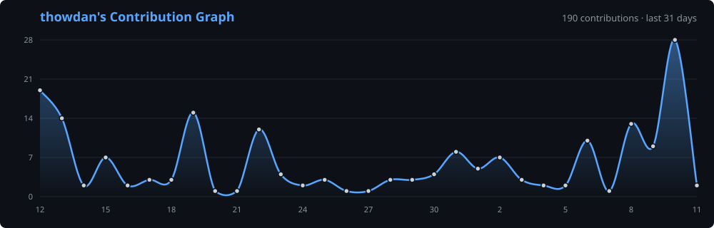

 

 

## 🚀 About Me

- 👨‍💻 **Full-stack software engineer** shipping production systems end to end — React & Next.js front ends, Node.js & TypeScript services, PostgreSQL data layers on Vercel
- 🏗️ Founder of **[TB3 Technologies](https://tb3technologies.tech/work)** — shipped **10+ web, mobile, AI & IoT products**, including **4 client platforms** live in 🇪🇬 Egypt, 🇸🇦 Saudi Arabia and 🇷🇴 Romania
- 🥈 **Silver Medal** — Huawei ICT Competition, National Phase 2024–2025
- 🏆 **Best Graduation Project** (IT Dept.) & 4th university-wide — RoboFireFighter
- 📄 Co-author of *“Smart Fire Firefighting Robot Using Deep Learning and IoT”* (submitted) — 94% detection accuracy
- 🎓 **B.Sc. Information Systems** (2026) — Misr University for Science and Technology
- 🌍 Arabic (native) · English (professional)
- 📫 **[thowdan64@gmail.com](mailto:thowdan64@gmail.com)** · 👉 **[thowdanaleryani.vercel.app](https://thowdanaleryani.vercel.app/)**

 

## 🛠️ Tech Stack

#### Languages

#### Frontend & Mobile

#### Backend & Data

#### AI & Machine Learning

#### Security

#### Cloud, DevOps & IoT

 

## 💼 Featured Work

| Project | What it does | Stack |
| --- | --- | --- |
| 🦷 **[Elias Dental](https://tb3technologies.tech/work/elias-dental)** | Bilingual (EN/RO) dental practice platform — DB-level overlap prevention ends double-booked appointments | Next.js 16 · React 19 · TypeScript · Neon PostgreSQL · Zod |
| 🪑 **[Jawdat Khashab](https://tb3technologies.tech/work/jawdat-khashab)** | Furniture e-commerce shipped in 1 week — transactional orders & inventory reservations prevent overselling | Next.js 16 · Prisma 7 · PostgreSQL · JWT |
| 🍳 **[Blum for Kitchens](https://tb3technologies.tech/work/blum-for-kitchens)** | Arabic-first platform for 4 Saudi branches — protected lead dashboard, bot protection, local SEO | Next.js · next-intl · Upstash Redis · JSON-LD |
| 🔥 **[RoboFireFighter](https://tb3technologies.tech/work/robofirefighter)** | 🏆 Best Graduation Project — Flutter control app for an autonomous firefighting robot, live feeds & 3-tier alerts | Flutter · Dart · Supabase · Raspberry Pi · YOLOv11 |
| ⚡ **[RealtimeHub](https://tb3technologies.tech/work/realtimehub)** | Chat, tasks and files in one app with live multi-user sync | React · TypeScript · Node.js · Express · Socket.IO · PostgreSQL · Redis |
| 🧠 **[SnipCheck](https://tb3technologies.tech/work/snipcheck)** | AI code-analysis REST API returning schema-validated JSON, with API keys & rate limiting | Node.js · Gemini API · Structured JSON Output |
| 🛡️ **[VECTOR/SEC](https://tb3technologies.tech/work/vector-sec)** | Security assessment tool — risk-scores public targets across 6 checks behind an SSRF-guarded endpoint | Serverless · TypeScript |
| 🎛️ **[DiffGear](https://tb3technologies.tech/work/diffgear)** | Interactive 3D WebGL brand site | WebGL · JavaScript |

📂 More case studies → **[tb3technologies.tech/work](https://tb3technologies.tech/work)**

 

## 📊 GitHub Analytics

<!-- These cards are generated by .github/workflows/profile-cards.yml (runs daily) -->

  

  

  

 

## 🐍 Contribution Snake

<picture>
  <source media="(prefers-color-scheme: dark)" srcset="https://raw.githubusercontent.com/thowdan/thowdan/output/github-contribution-grid-snake-dark.svg" />
  <source media="(prefers-color-scheme: light)" srcset="https://raw.githubusercontent.com/thowdan/thowdan/output/github-contribution-grid-snake.svg" />
  
</picture>

 

## 🌐 Connect With Me

 

---

 

<i>⭐ Turning ideas into working products — one commit at a time.</i>

